# Duplikill

Thin out a big photo archive or sereis of burst shots fast: zoom in and out ... similar shots are compared side
by side, you cross out, and you move on.

**[⬇ Duplikill-Setup.exe](https://github.com/metamountain/duplikill/releases/latest/download/Duplikill-Setup.exe)** (installer) ·
**[⬇ Portable ZIP](https://github.com/metamountain/duplikill/releases/latest/download/Duplikill-Portable-win64.zip)** ·
Windows 10/11, 64-bit, no Python needed.


> **Real archive, one year:** 4,702 photos. Rescan: **0.3 s**. Found **297 exact copies** spread over 2 album
> folders: **1.8 s**. Cleaned up with **2 keypresses**, tags kept, undo with one `Ctrl+Z`.

## 1. Merge exact copies (across folders and inside one folder)

Built an album by copying from a dump folder, or ended up with `IMG_1234 (1).jpg` duplicates in the same folder?
Duplikill finds pictures that exist in two folders or inside the same folder **byte-identical or with the same
picture data**, even if only one copy carries tags (for a JPEG the image data from the first SOS marker is compared,
not the metadata).
Each folder pair (or folder with internal copies) gets one question:

- `Enter`: keep them in the album (or keep the clean original filename in same-folder merges), remove the duplicate
  copies all at once. `T` turns a two-folder merge round, `B` = best-of folder (keep both), `Esc` = later.
- **Tags survive:** if the copy that goes has more metadata (XMP/IPTC, sidecars), it takes the untagged one's place.
  Duplikill never rewrites the metadata inside your pictures.

## 2. Compare similar shots & photo series



- **The whole group on one screen**, edge to edge, with the **BEST** (sharpest full-size) image placed first on the
  top-left.
- **Synchronous zoom:** the mouse wheel zooms every image into the same spot; from 100 % pixel for pixel from the
  original, so blur and noise show.
- **Blink:** hold the right mouse button and every image shows its neighbour at the same spot.
- **Heart & Lock:** click **BEST** (`♥`) to mark all other images for removal (`KEEP BEST`), or click **ONLY** (`🔒`)
  on any image to keep only that one.
- **Click = cross, `Del` = remove and next group.** The **skull** removes one image at once.

## Fast & accurate

- **Scan: [Czkawka](https://github.com/qarmin/czkawka)** by Rafał Mikrut ([@qarmin](https://github.com/qarmin)),
  the Rust engine behind Krokiet: about 80 new photos/s (4,108 photos: 53 s), seen ones from its cache in seconds.
- **Multi-stage verification & EXIF time-series recovery:**
  - **Time-series rescue:** shots taken within the same EXIF time window are checked even when a slight camera step or
    pan shifted their 8×8 gradient hash out of Czkawka's candidate bucket.
  - **Shift-tolerant structure + foreground detail:** 24×24 greyscale correlation allows up to ±2 grid cells (~8 %) of
    camera pan/zoom within a series, while a 5×5 local high-pass detail filter ignores uniform studio walls or skies.
  - **Burst exposure/flash invariance:** burst shots (`≤ 15 s`) with high structural correlation compare normalized
    chroma layout so flash or auto-exposure jumps do not split a burst.
  - **Average-linkage with floor:** a group holds only if every image matches every other one without chaining.
    2,400 photos in 400 groups: 0.14 s.
- **Results are saved:** reopen a folder and groups, crosses and position are back at once.
- **Live similarity slider** in the overview: scales both Czkawka and the verification/time-series thresholds in a
  fraction of a second.

## Safe

- Files are **moved**, not deleted, to `<drive>:\Duplikill-Bin\<original path>` (instant, XMP sidecars along).
  Recycle bin or permanent delete can be chosen in the settings.
- `Ctrl+Z` undoes the last step (a whole merge too). `B` shows everything removed; pick images, `R` puts them back,
  also days later.
- One image of every group always stays. Nothing goes without your click.

## Controls

| Input | Action |
|---|---|
| Click image · `Del` | cross · remove crossed, next group |
| Skull on an image | remove just this image now |
| `KEEP BEST` / `ONLY` | cross out all but the best / all but this one |
| Wheel · `0` · middle drag | synchronous zoom · fit · pan |
| Hold right · `Tab` | blink compare · one image alone |
| `Space` `→` / `←` | next / previous group |
| `Ctrl+Z` · `Esc` | undo · one step back |
| `S` · `F1` · `F11` · `B` | settings · help · fullscreen · bin |
| `U` · `F8` | install update · report a bug |

Excluded folders and best-of folders: settings (`S`).

## Privacy

Nothing is sent by itself. At start Duplikill asks GitHub for a newer release. `F8` and "share numbers" open a
prefilled GitHub issue (paths removed) that you read and submit yourself.

## Build from source

```powershell
python -m venv .venv
.venv\Scripts\pip install -r requirements.txt
.venv\Scripts\python -I tools\build_exe.py                  # exe + portable ZIP + Setup.exe
.venv\Scripts\python -I -m duplikill --dry-run              # run without touching any file
.venv\Scripts\python -I tools\dupliprompt.py "C:\Photos"    # headless CLI & pair diagnostics (-q, --groups, --scan)
.venv\Scripts\python -I -m pytest -q tests
```

## Technical architecture & detection pipeline

| Stage / Module | How it works |
|---|---|
| **1. Candidate generation (`czkawka.py`, `verify.py`)** | Runs `czkawka_cli image` (`8×8` Gradient hash, Nearest filter, cached in `%LOCALAPPDATA%\Qarmin\Czkawka\cache`) and unions its groups with same-folder EXIF time-series runs (`DateTimeOriginal` within `series_gap`, up to `15 min`). |
| **2. Signature cache (`verify.py` · `signatures.sqlite`)** | Decodes each image once on all CPU cores (`1/8` JPEG draft mode, EXIF-transposed): stores a normalized `24×24` luminance vector (`576 × float32`), a `4×4×3` RGB colour layout (`48 × float32`), EXIF timestamp (`taken`), and `1024 px` Laplacian variance (`sharp`). |
| **3. Shift, detail & chroma verification (`verify.py`)** | Every candidate pair is checked across four criteria:<br>• **Shift-tolerant structure (`_corr_matrix`):** `24×24` correlation with symmetric `±2` cell (`~8 %`) 2D translation tolerance for shots taken within `series_gap`.<br>• **Foreground detail (`_highpass_greys`):** `5×5` local high-pass correlation (`≥ min_hp_corr`) strips uniform backgrounds (studio walls, sky) so unrelated subjects on identical backgrounds drop out.<br>• **Colour & burst chroma (`_effective_cdist`):** mean `4×4` RGB distance (`≤ max_cdist`); for high-correlation bursts (`dt ≤ 15 s`, `corr ≥ 0.90`), mean RGB offset is subtracted so flash or auto-exposure jumps do not split a burst.<br>• **Date & linkage (`_fits`, `_agglomerate`):** shots must be from the same EXIF day (unless `corr ≥ 0.90` copy); clusters are built via average-linkage with a strict per-pair floor (`loose_corr`, `loose_cdist`) to prevent chaining. |
| **4. Live strictness scaling (`thresholds_for`)** | The `STRICT <0..17> LOOSE` slider scales both Czkawka's hash distance and `verify.py` thresholds (`min_corr 0.84..0.56`, `min_hp_corr 0.30..0.20`, `max_cdist 0.07..0.135`, `series_gap 0..900 s`, shift `0..±2`). |
| **5. Exact copy & folder merge (`copies.py`, `bestof.py`)** |Hashes JPEG bitstream from the first `SOS` (`0xFFDA`) marker with `blake2b-128` (ignoring header tags) and scores metadata richness (XMP + IPTC bytes + sidecars). Offers one-key cross-folder and same-folder merges (`≥ 5` copies) that swap richer metadata onto the clean keeper filename, plus best-of folder exclusion (`≥ 50 %` shared images). |
| **6. Non-destructive moves & sessions (`actions.py`, `session.py`)** | Moves files + XMP sidecars to `<drive>:\Duplikill-Bin` with an append-only JSONL journal for multi-level `Ctrl+Z` undo and `BinView` (`B`) selective restore. Sessions are cached by folder fingerprint (`count`, `bytes`, `sum(mtime)`), updated in-place on moves/undos. |
| **7. Headless CLI (`dupliprompt.py`)** | `dupliprompt.cmd <folder> [-s 0..17] [--scan] [--groups] [-q <names...>]` runs the full pipeline without a GUI and prints EXIF timestamps, time deltas, raw vs. shifted correlation, `5×5` high-pass detail correlation, raw/chroma colour distance, and exact match/drop reasons for every queried image pair. |

## Credits & license

[Czkawka / Krokiet](https://github.com/qarmin/czkawka) by Rafał Mikrut (MIT) · pixel font
[c64font](https://github.com/zeiche/c64font) (CC0) · Duplikill: [MIT](LICENSE)
