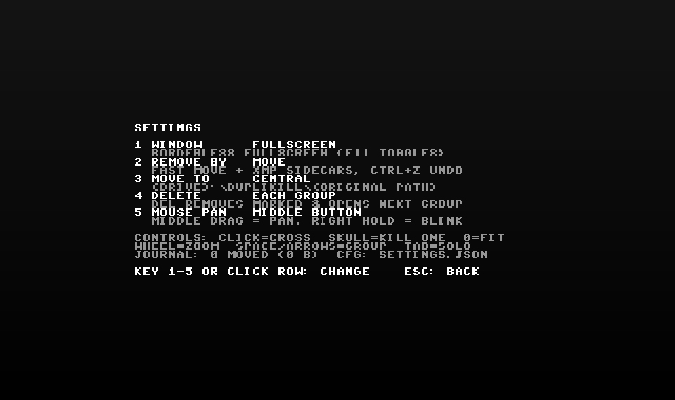

# Duplikill

Thin out a big photo archive, **blazingly fast**. Duplikill scans thousands of high-res photos in seconds, finds duplicate and similar series with zero false-positive chains, shows every group **edge-to-edge on one screen**, you cross out what should go, fire, next group.

### Why the Scan Engine Is So Fast

- **Stage 1 — The [Czkawka](https://github.com/qarmin/czkawka) & [Krokiet](https://github.com/qarmin/czkawka/tree/master/krokiet) Rust Scan Engine (by Rafał Mikrut / [@qarmin](https://github.com/qarmin)):** All credit for the raw Stage-1 file & image-hashing engine goes to **Rafał Mikrut**, the inventor of **Czkawka** and its modern frontend **Krokiet**. His multi-threaded Rust scanner is an absolute beast — tearing through uncached folders at ~80–400 images/s and re-scanning cached archives (`> 1,000 images/s`) in a split second. Duplikill shares `%LOCALAPPDATA%\Qarmin\Czkawka\cache` directly with Krokiet, so any folder Krokiet has ever scanned opens almost instantaneously.
- **Stage 2 — Vectorized 2-Pass Verification & Series Merger (`~0.14 s` for 400 groups / 2,400 photos):** Fast 8×8 hashes alone can group unrelated lookalikes or split long burst series. Duplikill decodes 1/8-scale JPEG drafts across all CPU cores, computes 24×24 greyscale structure correlation (`≥ 0.6`), 4×4 colour distance (`≤ 0.12`), 2D Laplacian sharpness, and EXIF capture timestamps (`DateTimeOriginal`), then runs a **two-pass vectorized agglomerative verifier**:
  1. **Pass 1 (`refine`):** Splits out false lookalikes using average linkage with a strict floor (no transitive A→B→C chaining).
  2. **Pass 2 (`merge`):** Re-unites burst series that Stage 1 split across multiple groups (`≤ 15 min`), backed by a versioned cluster-state cache and chunked SQLite signature storage (`~20 ms` to load 3,000 signatures).
- **CUDA + Multi-Core Engine (`index.py` / `groups.py`):** Includes a hybrid CPU/GPU pipeline where multi-core processes decode 1/8-scale greyscale drafts ahead of the GPU while `torch.cuda` computes 64-bit DCT perceptual hashes, Laplacian sharpness, and 4096×4096 LUT-popcount Hamming distance matrices in batches of 256.

Black and white, integer-scaled 8×8 C64 pixel font, 60 FPS spring-reverb overview, keyboard and mouse driven. Windows. By **metamountain**.

---

## Screenshots & Workflow

### 1. Overview (Floating Net & Folder Clumps)
Few groups float as a live physics net of real thumbnails joined by folder lines; large archives switch automatically to organic pixel clumps (one square per photo, well above 30 fps). The similarity slider (`STRICT <######......> LOOSE`) re-queries the cache in a fraction of a second.


### 2. Review (Edge-to-Edge Compare with Central Seam Switches)
Every group fills the screen edge to edge (`2 px` seam). All action switches cluster right around the **central seam `(W/2, H/2)`** so mouse travel stays minimal (~45 px) and photo centers (faces/subjects) are never covered:
- **2-image pairs:** Both `[☠]` instant-remove switches sit left and right of the vertical center seam directly above the `< i/N >` hub. Clicking one photo sets an `X`; clicking the other swaps the `X` in 1 click.
- **Multi-image groups & bursts (e.g. 6 photos):** Each cell has `[ONLY] [☠]` at its inner seam corner. Click any subset of photos to cross them out (e.g. keep 3 of 6), or click `[ONLY]` / `[KEEP BEST]` to cross out all others in 1 click, then fire `[🗑 n X DEL]` right at the center.


### 3. Settings (`S`)
Fixed-grid C64 menu with explanatory help lines under every setting, configurable mouse pan (`MIDDLE BUTTON` vs `RIGHT BUTTON`), live journal statistics, and JSON configuration (`%LOCALAPPDATA%\Duplikill\settings.json`).



---

## How It Works

1. **Open a folder.** Scans estimated over 90 seconds show a warning with the cached percentage and a 1–9 shortcut list of the largest subfolders.
2. **Two-stage ultra-fast search:**
   - **Stage 1 — [Czkawka](https://github.com/qarmin/czkawka) / [Krokiet](https://github.com/qarmin/czkawka/tree/master/krokiet) Rust engine (`@qarmin`):** Multi-threaded 8×8 gradient hashing tears through uncached folders at ~80–400 images/s and re-queries cached archives (`> 1,000 images/s`) in a split second. Shares `%LOCALAPPDATA%\Qarmin\Czkawka\cache` directly with an installed **Krokiet** / **Czkawka**, so anything Krokiet has hashed is instant in Duplikill too.
   - **Stage 2 — Vectorized `verify.py` refinement (`~0.14 s` for 400 groups / 2,400 photos):** Re-verifies every candidate pair via 24×24 greyscale structure correlation (`≥ 0.6`), 4×4 colour layout distance (`≤ 0.12`), Laplacian sharpness, and EXIF capture date (`DateTimeOriginal`). Rebuilds groups with average linkage + floor (eliminating false lookalikes and transitive chaining) and merges burst series split by Stage 1 (`≤ 15 min`). Signatures are batch-cached in `%LOCALAPPDATA%\Duplikill\signatures.sqlite` (`~20 ms` for 3,000 rows).
3. **Safe removal & undo:**
   - By default, **removing means moving**: files (plus `.xmp` sidecars) move instantaneously to `<Drive>:\Duplikill\<original path>` on the same drive (no byte copying), logged in `journal.jsonl`, and can be undone anytime with `Ctrl+Z`.
   - In Settings (`S`), you can switch the move target to `<Scanned Folder>\Duplikill\<path>` or a custom folder, or switch removal to the Windows Recycle Bin or permanent deletion (asked once per session).

---

## Controls (Review)

| Input | Action |
|---|---|
| Left click on an image | Toggle delete cross `X` (on 2-image pairs: clicking the other image swaps the cross in 1 click) |
| Skull `[☠]` (inner seam corner of each image) | Remove this one image immediately |
| `[ONLY]` (inner seam corner, 3+ images) | Cross out all other images in the group (click another photo to keep 2 or 3) |
| `[KEEP BEST]` (central hub, 3+ images) | Cross out all except the sharpest / highest-resolution `BEST` image |
| `Del` / `Backspace` / central `[🗑 n X DEL]` | Remove crossed-out images and advance to the next group |
| Central `<` / `>` or `Space`, `→` / `←` | Previous / next group |
| Mouse wheel | Synchronous zoom into the cursor spot across all images (pixel-exact from 100 %) |
| Middle drag (or Right drag, configurable in `S`) | Synchronous pan across all images |
| Hold Right button (or Middle button) | Blink compare: every cell shows the next image at the exact same zoom & spot |
| `Tab` / mouse side buttons | Solo single image / cycle to next |
| `0` / `Home` | Reset zoom to fit |
| `Ctrl+Z` | Undo last move (restores files + XMP sidecars and reopens the group) |
| `Esc` | One level back (double `Esc` on the start screen quits) |
| `S` | Open Settings (from start screen or overview) |
| `F1` | Open / close Help overlay from any screen |
| `Del` (in overview, `AT THE END` mode) | Remove all crossed-out images across all groups at once |
| `F11` | Toggle borderless fullscreen / dark window |

At least one image of a group always stays. Nothing is ever removed automatically.

---

## Build & Run

Requires Python 3.14 and Windows 10/11.

```powershell
python -m venv .venv
.venv\Scripts\pip install -r requirements.txt
```

Download `windows_czkawka_cli.exe` 12.0.2 from the [Czkawka releases](https://github.com/qarmin/czkawka/releases) and place it into `tools\`.

```powershell
.venv\Scripts\python -I -m duplikill --dry-run      # run without touching files
.venv\Scripts\python -I -m pytest -q tests          # run test suite
.venv\Scripts\python -I tools\build_exe.py          # build dist\Duplikill\Duplikill.exe
```

---

## Credits & License

- **Huge shout-out to Rafał Mikrut ([@qarmin](https://github.com/qarmin))**, the creator of **[Czkawka](https://github.com/qarmin/czkawka)** and **[Krokiet](https://github.com/qarmin/czkawka/tree/master/krokiet)** (MIT) — his uncompromisingly fast multi-threaded Rust scanner and shared cache architecture make Duplikill's raw scan speed possible.
- [C64 font](https://github.com/zeiche/c64font) (CC0), see `tools/fonts/LICENSE-c64font.md`.
- Licensed under the [MIT License](LICENSE).
