# Duplikill

Thin out a big photo archive fast: exact copies go in one keypress per folder, similar shots are compared side
by side, you cross out, and you move on.

**[⬇ Duplikill-Setup.exe](https://github.com/metamountain/duplikill/releases/latest/download/Duplikill-Setup.exe)** (installer) ·
**[⬇ Portable ZIP](https://github.com/metamountain/duplikill/releases/latest/download/Duplikill-Portable-win64.zip)** ·
Windows 10/11, 64-bit, no Python needed.



> **Real archive, one year:** 4,702 photos. Rescan: **0.3 s**. Found **297 exact copies** spread over 2 album
> folders: **1.8 s**. Cleaned up with **2 keypresses**, tags kept, undo with one `Ctrl+Z`.

## 1. Merge folders with exact copies

Built an album by copying from a dump folder? Duplikill finds pictures that exist in two folders **byte-identical
or with the same picture data**, even if only one copy carries tags (for a JPEG the image data is compared, not
the metadata).
Each folder pair gets one question:

- `Enter`: keep them in the album, remove the copies from the other folder, all at once. `T` turns it round,
  `B` = best-of folder (keep both), `Esc` = later.
- **Tags survive:** if the copy that goes has more metadata (XMP/IPTC, sidecars), it takes the untagged one's place.
  Duplikill never rewrites the metadata inside your pictures.

## 2. Compare similar shots


- **The whole group on one screen**, edge to edge.
- **Synchronous zoom:** the mouse wheel zooms every image into the same spot; from 100 % pixel for pixel from the
  original, so blur and noise show.
- **Blink:** hold the right mouse button and every image shows its neighbour at the same spot.
- **BEST** marks the sharpest full-size image; `KEEP BEST` crosses out the rest.
- **Click = cross, `Del` = remove and next group.** The **skull** removes one image at once.

## Fast

- **Scan: [Czkawka](https://github.com/qarmin/czkawka)** by Rafał Mikrut ([@qarmin](https://github.com/qarmin)),
  the Rust engine behind Krokiet: about 80 new photos/s (4,108 photos: 53 s), seen ones from its cache in seconds.
- **Verification:** every pair is checked for structure, colour and date; a group holds only if every image matches
  every other one. 2,400 photos in 400 groups: 0.14 s.
- **Results are saved:** reopen a folder and groups, crosses and position are back at once.
- **Similarity slider** in the overview: searches again in a fraction of a second.

## Safe

- Files are **moved**, not deleted, to `<drive>:\Duplikill-Bin\<original path>` (instant, XMP sidecars along).
  Recycle bin or permanent delete can be chosen in the settings.
- `Ctrl+Z` undoes the last step (a whole merge too). `B` shows everything removed; pick images, `R` puts them back,
  also days later.
- One image of every group always stays. Nothing goes without your click.

## Controls

| Input | Action |
|---|---|
| Click image · `Del` | cross · remove crossed, next group |
| Skull on an image | remove just this image now |
| `KEEP BEST` / `ONLY` | cross out all but the best / all but this one |
| Wheel · `0` · middle drag | synchronous zoom · fit · pan |
| Hold right · `Tab` | blink compare · one image alone |
| `Space` `→` / `←` | next / previous group |
| `Ctrl+Z` · `Esc` | undo · one step back |
| `S` · `F1` · `F11` · `B` | settings · help · fullscreen · bin |
| `U` · `F8` | install update · report a bug |

Excluded folders and best-of folders: settings (`S`).

## Privacy

Nothing is sent by itself. At start Duplikill asks GitHub for a newer release. `F8` and "share numbers" open a
prefilled GitHub issue (paths removed) that you read and submit yourself.

## Build from source

```powershell
python -m venv .venv
.venv\Scripts\pip install -r requirements.txt
.venv\Scripts\python -I tools\build_exe.py          # exe + portable ZIP + Setup.exe
.venv\Scripts\python -I -m duplikill --dry-run      # run without touching any file
.venv\Scripts\python -I -m pytest -q tests
```

## Credits & license

[Czkawka / Krokiet](https://github.com/qarmin/czkawka) by Rafał Mikrut (MIT) · pixel font
[c64font](https://github.com/zeiche/c64font) (CC0) · Duplikill: [MIT](LICENSE)
